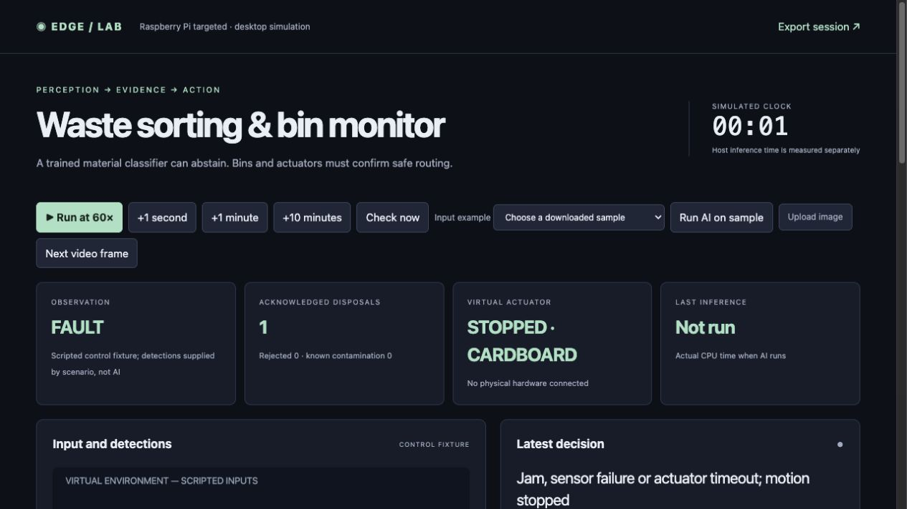

# Smart waste sorting and bin monitoring

A frozen MobileNetV3-small feature extractor and a genuinely trained linear classifier recognize cardboard, glass, metal, paper and plastic. Confidence rejection, mixed-material flags and bin checks can route an item to review. A disposal is counted only after actuator acknowledgement; jams, stale sensors and timeouts stop the simulated mechanism.

**Raspberry Pi targeted · desktop simulation tested · AI-assisted personal project.** Physical deployment is pending.



## Run locally

```sh
python3.12 -m venv .venv
.venv/bin/python -m pip install -r requirements.txt
.venv/bin/python app.py
# Open http://127.0.0.1:8813
```

Control scenarios run without pretrained models. For real inference, complete [model setup and demonstration](docs/setup-and-demo.md). The source archive excludes pretrained backbones and COCO photographs; a trained waste head is included where applicable.

## Measured comparison

| Metric | Baseline | Final | Scope |
|---|---:|---:|---|
| Known material accuracy (percent) | 62.168 | 90.265 | 452 held-out known images; HSV linear baseline vs frozen MobileNet features + trained linear head |
| Known material macro F1 (score) | 0.617 | 0.901 | Same 452 images; five material classes; forced-choice before rejection |
| Unsafe scripted disposals (cases) | 50.000 | 0.000 | 60 scripted score/fault cases; 10 normal acknowledgements |

Known-class accuracy rose from 62.17% to 90.27%, a 28.10 percentage-point gain (45.20% relative). The feature extractor costs more computation than a color histogram. The selected rejection rule recognized only 4 of 21 unknown-proxy images, or 19.05%. A confident prediction cannot establish purity or suitability for automatic disposal.

TrashNet contains mostly isolated objects and is not representative of dirty mixed waste streams. Exact duplicates are grouped, but physical-object/session identifiers are unavailable, so near-duplicate leakage cannot be excluded. Trash is a narrow proxy for unfamiliar items. In 60 mixed-image composites, only 16 were rejected. Dirt, resampling and black masks are synthetic stress probes, not physical crushing, dirt or hidden contamination measurements.

## Evidence and documentation

- [Technical report PDF](docs/technical-report.pdf) and [editable Word report](docs/technical-report.docx)
- [Architecture](docs/architecture.png) and [state transition source](docs/state-machine.mmd)
- [Hardware interfaces and wiring plan](docs/hardware.md)
- [Dataset and model card](docs/model-and-data.md)
- [Dashboard panel guide](docs/dashboard-guide.md)
- [Code walkthrough, ten interview questions and exercises](docs/mentor-guide.md)
- [Version and failure history](docs/FAILURES.md)
- [Raw results](evidence/results.json), [comparison CSV](evidence/metrics.csv), and [test log](evidence/tests.txt)

## Validation scope

Raspberry Pi targeted, desktop simulation tested. No Pi, real sensor, electrical power, camera timing, motor or physical safety validation was performed. This is an AI-assisted personal engineering project; it does not establish professional seniority or independent authorship.

56 shared regression cases passed. Real inference and browser scenarios were checked separately. The benchmark and application clocks are separate: inference time is measured on the host; control traces use explicit simulation time. No production adoption, physical safety certification, Pi latency or measured energy is claimed.

Project contact: Abhijith Viswanathan · abhijithviswanathan03@gmail.com. Intended GitHub owner: abhijith-abhii. Repository publication requires that account's write access; no remote repository is claimed by this package.

## Generated stress input and additional graphs

[Explore the AI-generated image, actual model output and diagnostic graph](docs/generated-tests.md). The synthetic scene is available in the dashboard sample menu and is excluded from the held-out benchmark.
