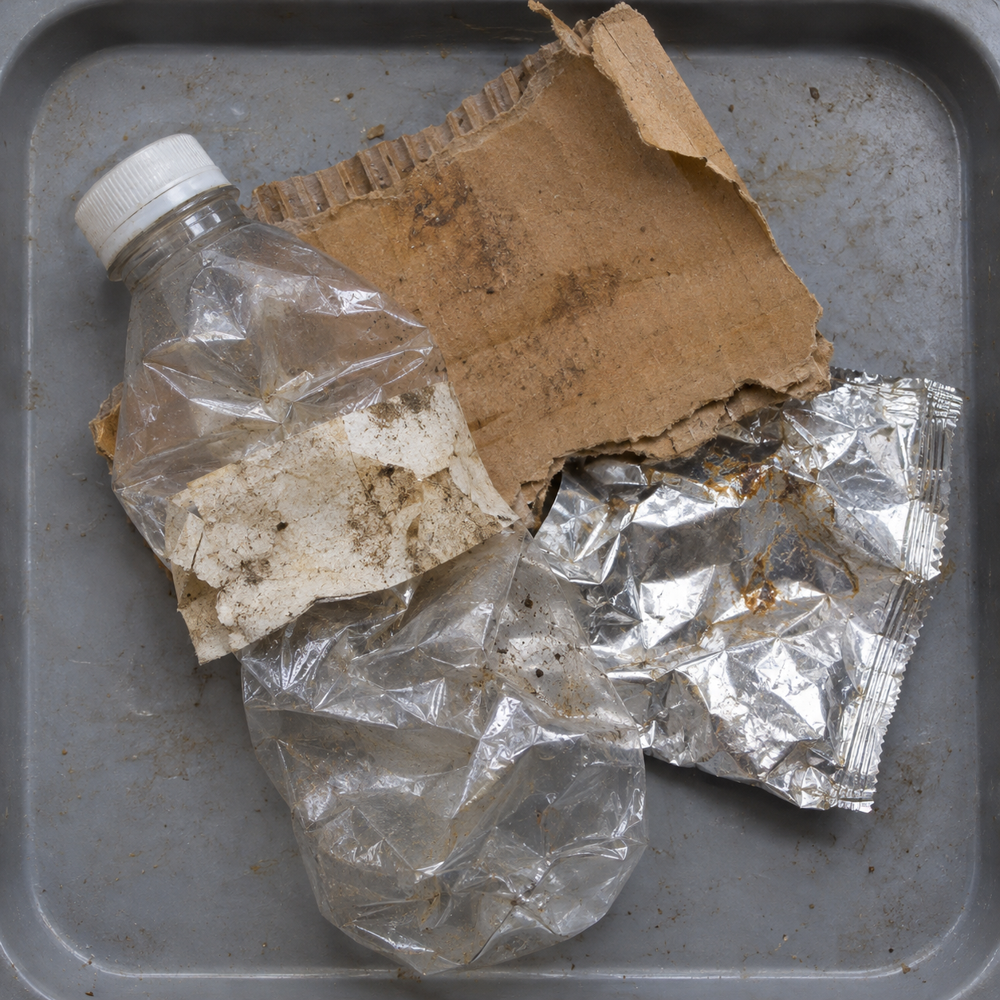
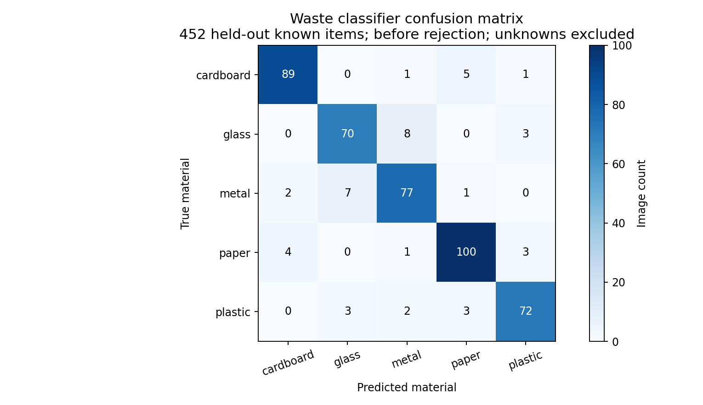

# Generated test image and diagnostic graphs

Human-reviewed synthetic scene: bottle, paper label, cardboard and foil overlap; expected operational outcome is manual review, not one pure material class.

Top class cardboard, score 0.821; threshold-only accepts this mixed scene. Explicit mixed-material flag is required for deterministic review.

Exploratory generated input, n=1 per project, no statistical accuracy claim, no training or threshold tuning, excluded from headline held-out benchmarks.

Generated using the built-in image tool. Full prompt and SHA256 are retained in samples/generated-test-provenance.json. Select the generated stress scene in the local dashboard to run actual inference again. It is separate from real COCO and TrashNet test images.

## Prompt

Use case: photorealistic-natural. Asset type: synthetic waste classification stress-test input. Generate one realistic square overhead photograph of a discarded crushed clear plastic drink bottle with a dirty paper label still attached, next to a torn piece of brown cardboard and a crumpled aluminum foil wrapper, all partly overlapping on a neutral gray sorting tray. Realistic dirt and texture, mixed materials intentionally ambiguous. No branding, text, logos, bounding boxes, graphics or captions. This synthetic image will test manual-review behavior; it is not a product advertisement.

## Diagnostic graph

The graph below uses preserved evaluation results, not invented results for the generated scene.
